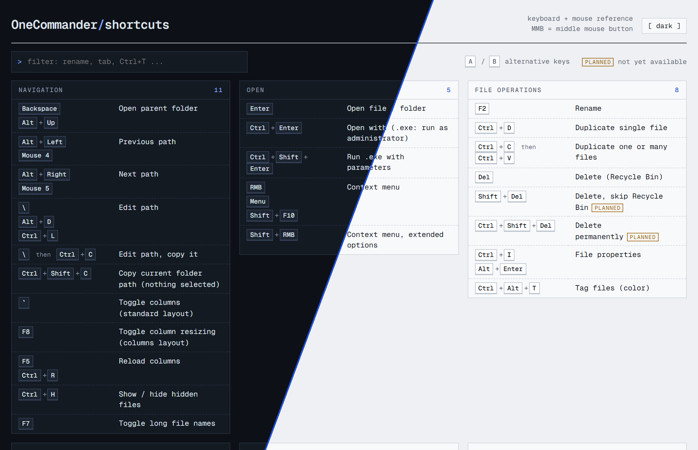

# OneCommander Cheat Sheet

A searchable, single-page cheat sheet of keyboard and mouse shortcuts for [OneCommander](https://onecommander.com), the dual-pane file manager for Windows.

**Live:** https://klggr.de/portfolio/15-OneCommander-Cheat-Sheet/onecommander-shortcuts.html

## Features

- Shortcuts grouped into 12 sections: navigation, open, file operations, create, clipboard, selection, tabs, dual pane, preview, search + filter, window + system and terminal
- Filter as you type, by action ("rename", "tab") or by key combo ("Ctrl+T")
- Alternative combos for the same action are listed together
- Announced but not yet available shortcuts are marked *planned*, system-wide hotkeys *[sys]*
- Dark and light mode (follows the system, with a manual toggle)
- Works on mobile
- One HTML file, no dependencies apart from the Geist Mono web font

## Usage

Open `onecommander-shortcuts.html` in a browser. To add or change a shortcut, edit the `DATA` list in the script at the bottom of the file.

## Sources

Based on the [official shortcut list](https://onecommander.com/help2/Shortcutkeys.html), cross-checked with DefKey. Reviewed by [m1l](https://github.com/m1l).

Spotted a wrong or missing shortcut? Open an issue or a pull request.

## License

[GNU General Public License v3.0](LICENSE)
